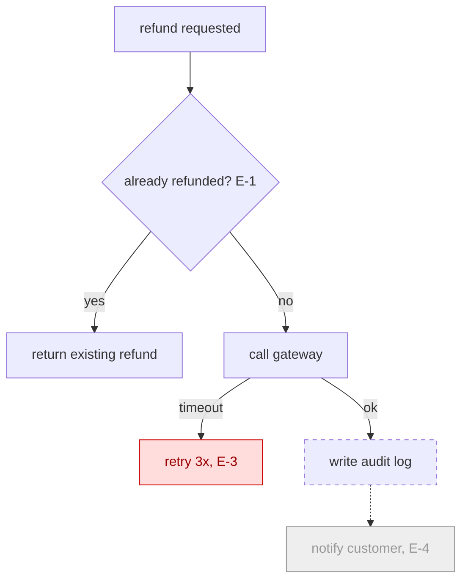

Write the brief a reviewer reads instead of the diff. They decide in a minute or two, often across many PRs, and they already approved the spec, so they expect the PR to match it. The card leads with your suggestion and how sure you are, then shows spec against code, then the few calls only they can make. Everything else is folded away. You suggest. The human merges.

## Inputs

A PR number or URL (default: the current branch's PR). Optionally a spec path or link, and repo-specific risk patterns ("treat `billing/hooks/` as HIGH").

```bash
gh pr view <pr> --json number,url,title,body,baseRefName,headRefName,headRefOid,files,closingIssuesReferences
gh pr checks <pr>
gh pr diff <pr>
```

## 1. Find the spec

Look in this order and stop at the first hit:

1. a path or link the user gave
2. a spec linked from the PR body (a repo file, an issue, a doc)
3. issues the PR closes (`closingIssuesReferences`), read with `gh issue view <n> --comments`
4. a spec file in the repo that matches the branch or PR title, under `docs/` (`docs/spec/`, `docs/plan/`), `specs/` or `.scratch/`

Any format works: numbered ACs, user stories, a bulleted issue, a design doc. It counts as a spec only if it says what the change should do. An issue that only names a problem ("checkout is slow") is not one.

If nothing is found, stop and ask: "Where is the spec for PR #<n>? Give me a path or link, or say the PR body is the spec." Do not infer intent from the diff, the title or the commits. A baseline you made up would look like one the reviewer agreed to. If the user says the PR body is the spec, write `Spec: PR body` in the card header so the reviewer sees the baseline is the author's own account. If you cannot ask (a non-interactive run), print the question as the result and stop without a card.

## 2. Extract expected behaviors

List what the spec expects, one observable behavior per line: "refund issued once per order", not "refactor the refund service". Keep the spec's own IDs (`AC-3`, `R2`); number only what has none, `E-1`, `E-2`, … in spec order. Also note:

- the spec's intended flow, if it has one (a diagram, numbered steps). The card's diagram redraws it.
- its scope and never-touch paths, if it names them. Step 4 checks drift against them.

## 3. Spec vs code (sub-agent, fresh context, read-only)

Brief: the expected behaviors, the spec's flow if any, the diff, and the test files in the diff. Leave out the PR body. The auditor judges the code, not the author's description of it.

Task, under 400 words:

- for each behavior: `✓` matches, `≠ <how it differs>`, `✗ missing`, or `? can't tell`, with evidence: the test that shows it as `name (path:line)`, else the code as `path:line`, else `no test`
- behavior in the diff that no expected behavior asked for: `+`, with `path:line`
- the flow as the code implements it: nodes and edges, each tagged with a behavior ID or `+`

If you cannot spawn sub-agents, run the audit one after another in this session and say in the card that the audit and the rest of the card were not independent.

## 4. Mechanical checks (you, while the audit runs)

**Risk tier from paths, never from size.** The highest matching tier wins. Line count never changes the tier. Name the files that set it.

| Tier | Paths or content |
|---|---|
| HIGH | schema or data migrations; auth, permissions, tenant or organization scoping; billing, credits, payments; deletes or bulk updates; secrets, CI, deploy config; external calls that write |
| MED | public API shapes (serializers, routes, response fields); background tasks; caches; anything behind a feature flag |
| LOW | everything else |

**CI and claims.** For each claim in the PR body ("tests pass", "verified on staging"), find its backing: a check in `gh pr checks` that is green at `headRefOid`, a command you re-run now, or an artifact you can open. Mark it `VERIFIED (<how>)` or `UNBACKED`. A ticked box or a sentence is not evidence. If the PR body claims nothing, run the repo's test and lint commands yourself and record the result. Note which of the auditor's tests actually ran green at `headRefOid` (in a check's log, or run them yourself). Step 5 needs that.

**Drift.**

- files touched outside the spec's scope or inside its never-touch paths
- tests deleted, skipped, or weakened (`git diff <base>...<head> -- <test globs>`: removed asserts, added skips, widened expectations)
- new suppressions (`noqa`, `type: ignore`, `nosec`, `eslint-disable`, `@ts-expect-error`)

## 5. Suggest, with confidence

Give every item a confidence: each row of the spec table, and each item under "Needs you".

- **HIGH**: proven by a green test or CI check the card cites. The test ran at `headRefOid`.
- **MED**: inferred from reading the code, with nothing proving it.
- **LOW**: a guess. The item names what would raise it ("a test that times out the gateway").

The card's confidence is the lowest among its items. One unproven row makes the whole card MED. That is the point: the reviewer sees where the proof stops.

**Needs you.** At most three items, only what code and CI cannot settle: a `≠`, `✗` or `?` row, a `+` that users or stored data will see, an `UNBACKED` claim that matters, a rollout call on a HIGH path (migration locking, an irreversible write). Keep the three that would most change the decision. Each one carries your suggested option, its confidence with the evidence (or why it is not higher), and one alternative. Never end an item with a question. If more than three remain, list the rest under "Also open" in the details and say in the lead that the PR should be split.

**MERGE or HOLD.** Suggest what you would do if the reviewer took every suggestion under "Needs you". These always mean HOLD, whatever the items say:

- a `✗` row, or a `≠` you suggest fixing
- CI red or missing at `headRefOid`
- a test deleted, skipped or weakened with no reason in the spec
- changes inside never-touch paths

Otherwise suggest MERGE. A `?` or a `+` does not force HOLD. It lowers the confidence and usually becomes an item.

## 6. Write the card

````markdown
# PR #<n> — <title>                     Spec: <path, link or "PR body">

**Suggest: MERGE | HOLD** · confidence HIGH|MED|LOW · risk HIGH|MED|LOW (<files that set it>)
> One or two lines: does it match the spec, and the one thing that matters most.

## Spec vs code
```mermaid
(the spec's intended flow, redrawn from the diff)
```
| # | Expected (from spec) | Status | Evidence |
|---|---|---|---|
| E-1 | refund issued once per order | ✓ | test_refund_once (tests/refund.py:12), green in `ci/test` |
| E-3 | retry once on gateway timeout | ≠ retries 3× | refund.ts:88, no test |
| E-4 | customer notified | ✗ missing | — |
| —   | (not in spec) writes audit log | + | audit.ts:20 |

## Needs you (≤3, "None" allowed)
1. <what> (path:line)
   → **Suggest: <option>** (<confidence> — <evidence or why not higher>)
   alt: <the other option>

<details><summary>Evidence · Not verified · Drift · Rollout</summary>

**Verified**: claim · how checked · result · sha, one line each. `UNBACKED` claims too.
**Not verified**: mandatory. What no test, check or run covered. "None" allowed, blank not.
**Drift**: out-of-scope or never-touch files, weakened or skipped tests, new suppressions. "None" if none.
**Rollout**: revert profile (one commit? data migration?), feature flag, what to watch after merge and for how long.
**Audit**: independent sub-agent, or "same session, not independent".
**Also open**: items past the three above, if any.

</details>
````

**The diagram** is the spec's intended flow, with each step drawn as the code actually does it. Tag nodes with behavior IDs. Mark matches as plain nodes, deviations red, behavior not in the spec dashed, and expected steps the code lacks gray:



- Keep it under about 12 nodes. Fold runs of matching steps into one node ("validate input, E-1–E-2"). If the deviations still don't fit, that is the split signal.
- Keep Mermaid text plain so it parses. Never put `;` in a label. Wrap any label with `( ) [ ] { } < > # :` in double quotes. Don't name a node `end`.
- If there is no flow (a config change, copy, a dependency bump), replace the diagram with one line, `No flow to draw: <why>`, and let the table carry it.

**The first screen is the card**: everything above `<details>`. If it doesn't fit on one screen, say in the lead that the PR should be split and along which behaviors.

**Format.** Mermaid plus markdown by default, because GitHub renders both and the `<details>` fold. If the user asks for another format (plain text for a terminal, no Mermaid), keep the same sections in the same order.

Print the card. Offer once to post it as a PR comment. Post only on a yes, with `gh pr comment <pr> --body-file <file>`, never as a review event.

## Rules

- **Suggest, never act.** Never approve, request changes, or merge. No `gh pr review`, no `gh pr merge`. MERGE or HOLD is advice. The human acts.
- **HIGH needs a citation.** If you can't point to the green test or check, it is MED.
- **No spec, no card.** Ask where it is. A guessed baseline must never look like an agreed one.
- **Unbacked beats pleasant.** A green check outranks any sentence in the PR body. A claim without one is `UNBACKED`, not assumed.
- **The first screen is the card.** If it doesn't fit, say the PR should be split.
- **A blank "Not verified" is a failed card.** If you are unsure what was not verified, that is the content.
- **Size is not safety.** Risk comes from the paths the PR touches. A three-line migration is HIGH. A 900-line refactor behind a flag may be LOW.
