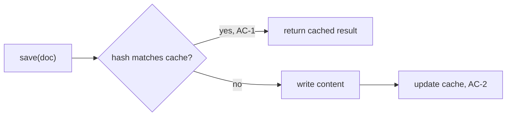

Implement the spec → PR loop yourself, in this session. No sub-agents and no review step. The spec is the only input. If the spec can't answer a question, stop and hand the question back.

Writing both the tests and the code yourself saves tokens. What you give up is a second, separate pair of eyes. Three mechanical checks make up for that, and none of them can be skipped: a red commit, a frozen test diff, and running the tests yourself.

## 0. Read the spec and the repo

**Spec.** Read it from wherever the user pointed. It must have numbered acceptance criteria (AC-n) and a scope. If either is missing, or an open `[NEEDS CLARIFICATION]` remains, stop and say what's missing. Use never-touch paths, a PR plan and a verification plan when the spec has them.

**PRs come from the spec.** Open the PRs the spec's PR plan lists, in its order, with its base branches. If the spec has no PR plan, open one PR. Never split or merge PRs on your own judgement.

**Repo.** Find these in the repo's own files (CLAUDE.md, CONTRIBUTING, Makefile, package.json, pyproject, CI config). State them in one message before you start:

- test command and test directory globs
- base branch and branch naming
- commit convention, and the framework's expected-fail marker (`xfail(strict=True)`, `it.fails`, `test.fail()`)
- lint/format command

Create the feature branch from the base branch. Never work on the base branch.

## 1. Per PR in the spec's plan

### 1a. Red

Write one test per AC in this PR. Name each test after its AC. It should assert observable behavior through the public interface. Take expected values from the spec. Don't recompute them the way the code would. Mark each test with the expected-fail marker.

Run the test command. Every new test must fail on an assertion, not on an import, fixture or syntax error. Fix only that kind of wrong-reason failure, then commit `test(<scope>): <behavior> [red]`. Record the red SHA.

From here on the tests are the oracle. If one looks wrong while you implement, stop and report it. Don't edit it.

### 1b. Green

Write the minimal implementation that makes the red tests pass. Stay inside the spec's scope. Remove the expected-fail markers. Commit `<feat|fix>(<scope>): <behavior> [green]`.

### 1c. Checks

Run each check and paste its output. Stop on the first failure.

1. `git diff <red-sha>..HEAD -- <test globs>` touches only marker lines. Any other change to a test means stop and report "tests modified after red". Don't revert and retry.
2. `git diff --name-only <base>..HEAD` lists only files inside the spec's scope, and nothing under never-touch.
3. Run the full test command. Exit code 0.
4. Run lint/format. Exit code 0.

### 1d. Open the draft PR

Push the branch and open a **draft** PR against the base branch the spec names.

**Shape of the change.** A reviewer should see what got built before reading any code. Draw it from the actual diff, not from the spec. If the two disagree, the reviewer needs to see that. Pick the one or two views that make the change clear, never all of them:

- a `diff` of pseudocode or a call tree, when behavior changed
- a `mermaid` flowchart or sequence diagram, when control flow branches or crosses components
- a `diff` of the file tree, when files were added, moved, or removed

Tag each AC where it lives in the visual (`# AC-1` in a diff, `|"yes, AC-1"|` on a Mermaid edge), so the AC table can point at it. Never paste a raw `git diff`. GitHub's Files tab already shows that, and these blocks show the shape of the code.

Keep Mermaid text plain so it parses, because a broken diagram renders as an error box. Never put `;` in a label or message, since Mermaid reads it as the end of a statement. Wrap any label that contains `( ) [ ] { } < > # :` in double quotes: `A["save(doc)"]`. Don't name a node `end`.

Body:

````markdown
## Intent
<spec intent, one or two sentences>

## Shape of the change

```diff
 on(save)
-  write content
+  if hash(content) == cache.hash        # AC-1
+    return cache.result
+  write new content
+  cache.set(hash, result)               # AC-2
```



## AC map
| AC | Where in the shape | Test | Status |
|----|--------------------|------|--------|
| AC-1 | cache-hit branch | tests/.../test_x.py::test_ac_1 | pass |

## Needs a human
- **Not verified:** <what no test or run covered; "None" is a claim, blank is not allowed>
- **Decided without the author:** <judgement calls where the spec was silent; "None" if none>

<details><summary>Evidence</summary>

- red: <red-sha>, tests frozen since (`git diff <red-sha>..HEAD -- <globs>`: markers only)
- tests: `<command>` exit 0 at <sha>
- lint: `<command>` exit 0 at <sha>
</details>
````

The visuals above are an example of the format. Replace them with the shape of this PR.

Print the PR URL. Then move on to the spec's next PR.

## Stop conditions

Stop and report instead of improvising when:

- the spec is not ready (section 0)
- a test never went red, or went red for the wrong reason and you couldn't fix that without changing what it asserts
- a test changed after the red commit
- the diff leaves the spec's scope or touches a never-touch path
- tests or lint fail and the fix would need a change the spec didn't ask for

## Never

- edit a test's assertions after the red commit
- spawn sub-agents
- merge, approve, or push to the base branch
- change the spec's PR plan
